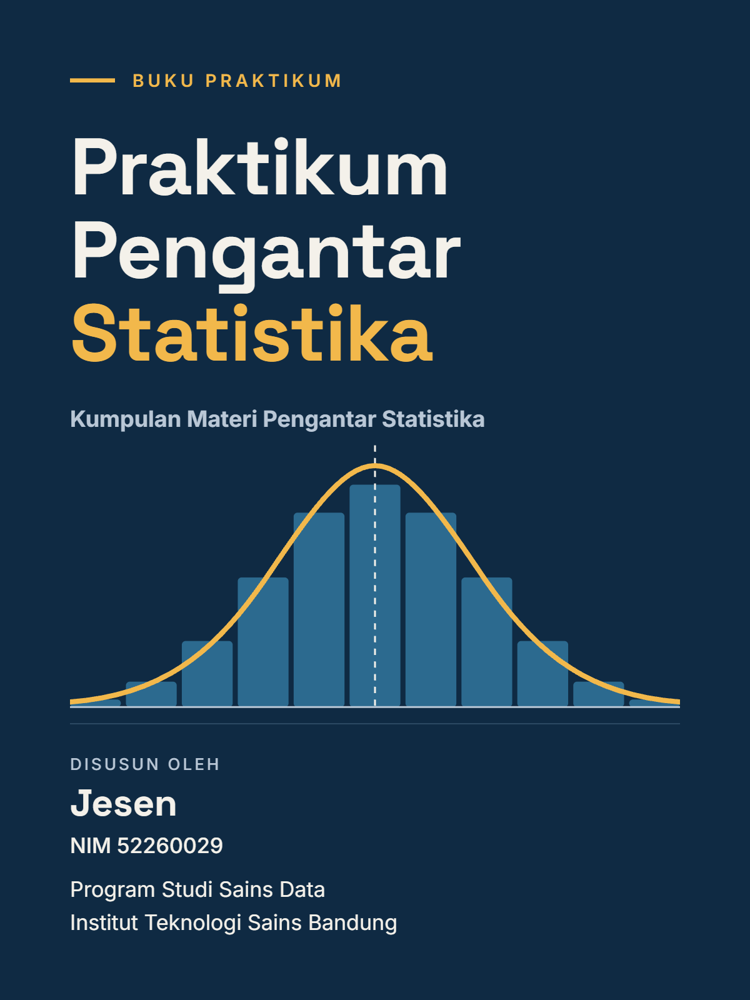

```{=html}
<div class="hero-buku">
  <svg viewBox="0 0 480 240" aria-hidden="true" xmlns="http://www.w3.org/2000/svg">
    <g fill="rgba(255,255,255,0.14)">
      <rect x="44" y="200" width="40" height="20" rx="3"/><rect x="88" y="168" width="40" height="52" rx="3"/>
      <rect x="132" y="118" width="40" height="102" rx="3"/><rect x="176" y="67" width="40" height="153" rx="3"/>
      <rect x="220" y="45" width="40" height="175" rx="3"/><rect x="264" y="67" width="40" height="153" rx="3"/>
      <rect x="308" y="118" width="40" height="102" rx="3"/><rect x="352" y="168" width="40" height="52" rx="3"/>
      <rect x="396" y="200" width="40" height="20" rx="3"/>
    </g>
    <path d="M0,216 C80,210 120,170 160,110 C190,66 215,30 240,30 C265,30 290,66 320,110 C360,170 400,210 480,216" fill="none" stroke="#F2B84B" stroke-width="4" stroke-linecap="round"/>
  </svg>
  <div class="hero-label"><span></span>BUKU PRAKTIKUM</div>
  <div class="hero-judul">Praktikum Pengantar<br><em>Statistika</em></div>
  <div class="hero-sub">Kumpulan Praktikum dan Materi Pengantar Statistika</div>
  <div class="hero-meta">
    <div><small>PENULIS</small><b>Jesen</b></div>
    <div><small>DITERBITKAN</small><b>25 November 2026</b></div>
  </div>
</div>
```

# Kata Pengantar {.unnumbered}

::: {.cover-kata}

:::

Puji syukur penulis panjatkan kepada Tuhan Yang Maha Esa atas eBook **"Praktikum Pengantar Statistika"** ini. Buku ini disusun sebagai kumpulan tugas praktikum yang penulis kerjakan selama mempelajari statistika, kemudian dirapikan dalam satu buku elektronik agar lebih mudah dibaca, dipelajari ulang, dan dibagikan.

Statistika merupakan dasar penting bagi mahasiswa Sains Data dalam memahami data, mulai dari menyajikan, meringkas, hingga menarik kesimpulan darinya. Melalui praktikum, konsep-konsep yang awalnya terasa abstrak di kelas dapat dicoba langsung dengan bahasa pemrograman R. Setiap bab dalam buku ini memuat materi, latihan beserta langkah pengerjaannya.

Buku ini ditulis menggunakan Quarto, sehingga teks, kode, hasil analisis, dan visualisasi data berada dalam satu dokumen yang dapat dijalankan ulang. Dengan begitu, hasil yang ditampilkan dapat ditelusuri dan diperiksa kembali oleh pembaca.

Penulis menyadari bahwa buku ini masih jauh dari sempurna. Sebagai mahasiswa yang masih dalam tahap belajar, penulis mungkin melakukan kekeliruan dalam penjelasan maupun penulisan kode. Karena itu, kritik dan saran dari pembaca sangat penulis harapkan untuk perbaikan ke depan.

Penulis mengucapkan terima kasih kepada Mr. Bakti Siregar, M.Sc. atas bimbingan selama perkuliahan dan praktikum, serta kepada teman-teman yang telah membantu dan memberi semangat. Semoga buku ini bermanfaat bagi pembaca yang sedang mempelajari statistika.


**Jesen**
Penulis


## Penulis

{.author-portrait width=1.5in fig-align="right" fig-pos="H"}

**[Jesen](https://www.linkedin.com/in/jesenn)** adalah mahasiswa S1 Program Studi Sains Data di Institut Teknologi Sains Bandung (ITSB). Saat ini ia sedang aktif mempelajari Python, statistika, R, analisis data, dan *machine learning* sebagai fondasi untuk memahami bagaimana data diolah menjadi informasi yang bermanfaat.

Ia tertarik pada kecerdasan buatan (*Artificial Intelligence*) dan penyelesaian masalah berbasis data, terutama bagaimana data dapat dimanfaatkan untuk mendukung pengambilan keputusan. Dalam proses belajarnya, ia terbiasa mempraktikkan langsung konsep yang dipelajari di kelas melalui latihan dan tugas praktikum, termasuk yang dikumpulkan dalam buku ini.

Buku **"Praktikum Pengantar Statistika"** ini menjadi salah satu langkah awal dalam mendokumentasikan perjalanan belajarnya. Sebagai mahasiswa yang masih terus belajar, ia terbuka terhadap masukan dan koreksi dari pembaca. Repositori buku ini dapat dilihat di [GitHub](https://github.com/sennie17).


## Ucapan Terima Kasih

Penyusunan eBook ini tidak terlepas dari bantuan dan dukungan berbagai pihak. Dengan penuh rasa hormat, saya ingin mengucapkan terima kasih kepada:

* **Mr. Bakti Siregar, M.Sc.**, dosen pengampu mata kuliah Pengantar Statistika di [Institut Teknologi Sains Bandung](https://itsb.ac.id/), atas ilmu, bimbingan, dan kesabaran selama perkuliahan dan praktikum. Tanpa arahan beliau, buku ini tidak akan dapat tersusun.
* **Para pembaca dan pengguna buku ini**, yang telah meluangkan waktu untuk membaca dan mempelajarinya. Kehadiran dan masukan Anda menjadi semangat bagi saya untuk terus belajar dan memperbaiki tulisan ini.

Saya berharap eBook ini dapat bermanfaat bagi siapa pun yang sedang mempelajari statistika, khususnya sesama mahasiswa yang baru mulai mengenal analisis data. Semoga ilmu yang tertuang di dalamnya dapat memberi manfaat bagi kita semua.

## Masukan & Saran

Buku ini disusun oleh seorang mahasiswa yang masih terus belajar, sehingga kritik, koreksi, dan saran dari pembaca sangat berarti untuk perbaikan ke depan. Jika Anda menemukan kekeliruan atau memiliki usulan, silakan sampaikan melalui kontak berikut:

**Email:** [jesentriago08@gmail.com](mailto:jesentriago08@gmail.com)
**LinkedIn:** [Jesen](https://www.linkedin.com/in/jesenn)
**GitHub:** [Laporkan masalah atau usulan](https://github.com/sennie17/STATISITKA-EBOOK/issues)
